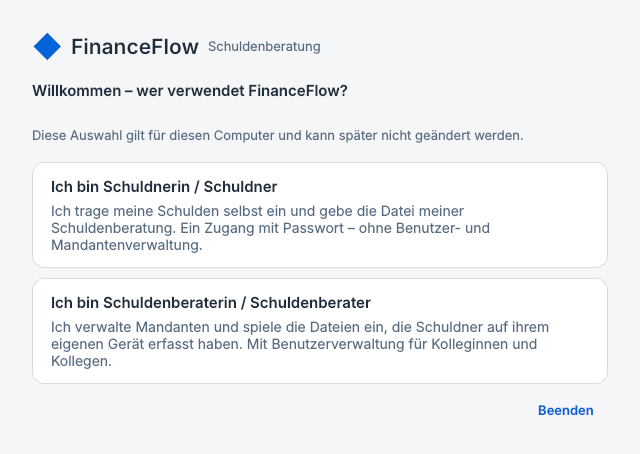
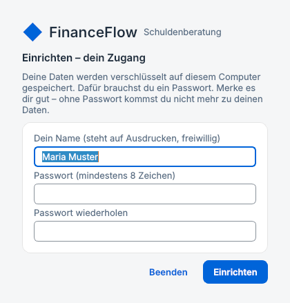
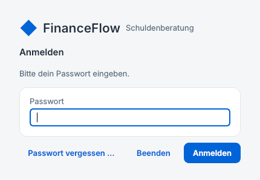
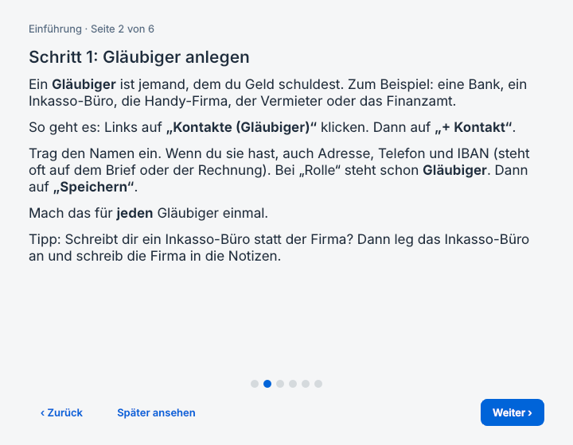
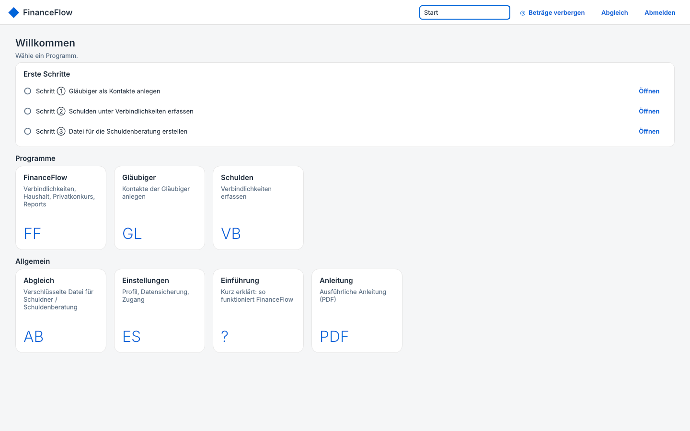
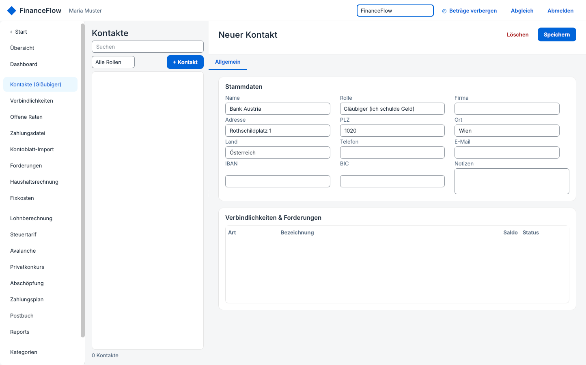
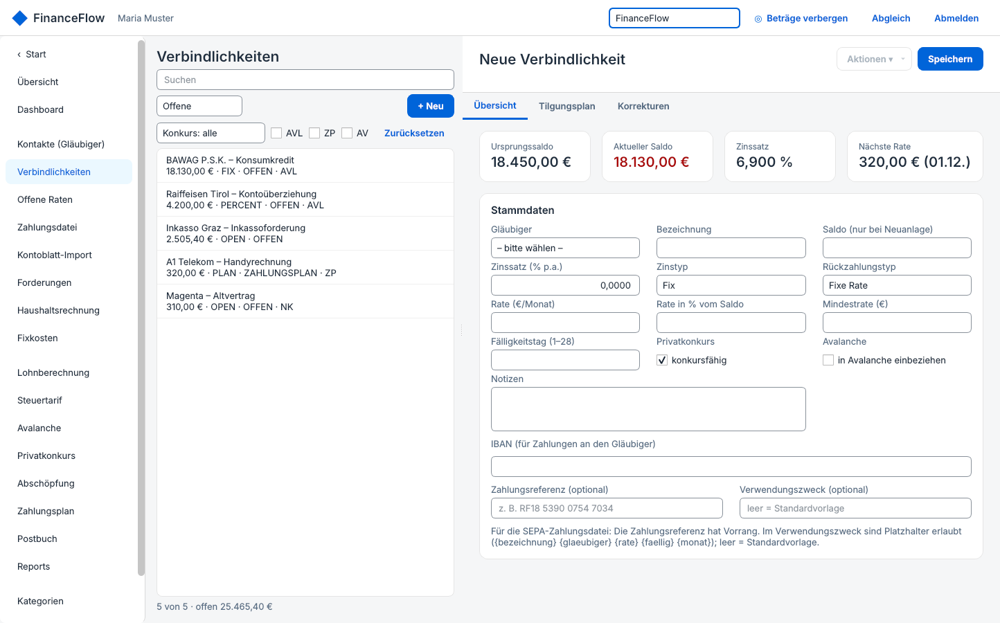
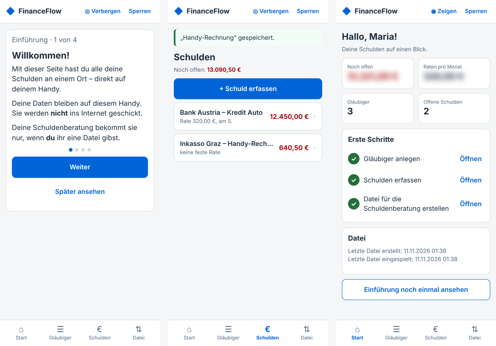

# FinanceFlow – Anleitung für Schuldnerinnen und Schuldner

Diese Anleitung ist in einfacher Sprache geschrieben. Du musst sie nicht auf einmal lesen. Fang mit den Kapiteln 1 bis 5 an. Den Rest liest du, wenn du ihn brauchst.

## 1. Was ist FinanceFlow?

FinanceFlow ist ein Programm für deinen Computer. Damit hast du alle deine Schulden an einem Ort.

Du siehst auf einen Blick:

- **Wem** du Geld schuldest.
- **Wie viel** noch offen ist.
- **Wann** die nächste Rate fällig ist.
- Was dir im Monat zum Leben **übrig bleibt**.

Deine Schuldenberatung arbeitet mit demselben Programm. Du kannst ihr deine Daten als **Datei** geben. Dann muss sie nicht alles noch einmal abtippen. Die Beratung bekommt deine Daten aber nur, wenn **du** ihr die Datei gibst.

> Deine Daten bleiben auf deinem Computer. Sie werden nicht ins Internet geschickt. Sie sind verschlüsselt. Ohne dein Passwort kann sie niemand lesen.

## 2. Installieren

1. Du bekommst von deiner Schuldenberatung die Datei **FinanceFlow-Schuldenberatung-….msi** (zum Beispiel auf einem USB-Stick oder per E-Mail).
2. Mach einen **Doppelklick** auf die Datei.
3. Windows fragt vielleicht: „Möchten Sie zulassen, dass durch diese App Änderungen an Ihrem Gerät vorgenommen werden?“ Klick auf **Ja**.
4. Warte, bis die Installation fertig ist. Das dauert weniger als eine Minute.
5. Auf deinem Desktop ist jetzt das Symbol **FinanceFlow Schuldenberatung**. Im Startmenü findest du es auch – dort ist auch diese Anleitung.

## 3. Der erste Start

Beim ersten Start fragt das Programm: **Wer verwendet FinanceFlow?**

1. Klick auf **„Ich bin Schuldnerin / Schuldner“**.
2. Trag deinen **Namen** ein. Er steht später oben auf deinen Ausdrucken. Das ist freiwillig.
3. Denk dir ein **Passwort** aus. Es muss mindestens 8 Zeichen lang sein. Gib es zweimal ein.
4. Klick auf **„Einrichten“**.

### Ganz wichtig: der Wiederherstellungsschlüssel

Danach zeigt dir FinanceFlow einen **Wiederherstellungsschlüssel**. Er sieht ungefähr so aus: `ABCD-EFGH-IJKL-…`

- Schreib ihn auf oder druck ihn aus. Klick dazu auf „Als Textdatei speichern …“ und druck die Datei aus.
- Heb ihn **gut** auf – zum Beispiel in einer Mappe bei deinen wichtigen Papieren. **Nicht** nur auf demselben Computer.
- Mit diesem Schlüssel kannst du ein neues Passwort setzen, wenn du dein Passwort vergisst.

> Wenn du dein Passwort vergisst UND den Wiederherstellungsschlüssel verlierst, sind deine Daten für immer weg. Niemand kann sie dann wiederherstellen – auch nicht die Schuldenberatung.

Setz das Häkchen bei „Ich habe den Wiederherstellungsschlüssel sicher notiert“ und klick auf **„Weiter“**.

## 4. Anmelden

Jedes Mal, wenn du FinanceFlow öffnest, gibst du dein **Passwort** ein und klickst auf **„Anmelden“**. Einen Benutzernamen brauchst du nicht.

## 5. Die Einführung und die Startseite

Beim ersten Anmelden erklärt dir eine **kurze Einführung** die wichtigsten Schritte. Mit „Weiter“ blätterst du um. Auf der letzten Seite kannst du gleich mit **„Jetzt ersten Gläubiger anlegen“** loslegen. Die Einführung findest du später jederzeit wieder auf der Startseite unter **„Einführung“**.

Nach dem Anmelden siehst du immer zuerst die **Startseite**. Dort stehen keine Beträge. So kannst du das Programm auch öffnen, wenn jemand neben dir sitzt.

Oben auf der Startseite steht **„Erste Schritte“**. Ein Kreis bedeutet: noch nicht erledigt. Ein Häkchen bedeutet: erledigt. Mit „Öffnen“ kommst du direkt zum richtigen Ort.

Links im Programm ist eine Liste mit allen Seiten. Mit **„‹ Start“** (ganz oben links) oder dem blauen Symbol links oben kommst du immer zurück zur Startseite.

## 6. Schritt 1: Gläubiger anlegen

Ein **Gläubiger** ist jemand, dem du Geld schuldest. Zum Beispiel:

- eine Bank (Kredit, Konto-Überziehung),
- ein Inkasso-Büro,
- die Handy- oder Internet-Firma,
- der Vermieter, die Strom- oder Gasfirma,
- das Finanzamt, die Krankenkasse (ÖGK), das Gericht,
- Freunde oder Familie, denen du Geld schuldest.

**So legst du einen Gläubiger an:**

1. Klick links auf **„Kontakte (Gläubiger)“**.
2. Klick auf **„+ Kontakt“**.
3. Trag den **Namen** ein, zum Beispiel „Bank Austria“.
4. Wenn du sie hast: **Adresse, PLZ, Ort, Telefon, E-Mail**. Die stehen meistens oben auf dem Brief.
5. Wenn du sie hast: die **IBAN** (die Kontonummer des Gläubigers). Die steht oft auf dem Zahlschein oder der Rechnung.
6. Bei **„Rolle“** steht schon „Gläubiger (ich schulde Geld)“. Das lässt du so.
7. Klick auf **„Speichern“**.

Mach das für **jeden** Gläubiger einmal.

> Tipp: Schreibt dir ein Inkasso-Büro statt der ursprünglichen Firma? Dann leg das **Inkasso-Büro** als Gläubiger an. Die ursprüngliche Firma schreibst du in das Feld „Notizen“.

## 7. Schritt 2: Schulden erfassen

Erst wenn der Gläubiger angelegt ist, trägst du die Schuld ein. In FinanceFlow heißen Schulden **„Verbindlichkeiten“**.

**So erfasst du eine Schuld:**

1. Klick links auf **„Verbindlichkeiten“**.
2. Klick auf **„+ Neu“**.
3. Wähl bei **„Gläubiger“** den richtigen Gläubiger aus der Liste.
4. Gib bei **„Bezeichnung“** einen kurzen Namen ein. Zum Beispiel „Kredit Auto“, „Handy-Rechnung“ oder „Miete Rückstand“.
5. Trag bei **„Saldo“** ein, wie viel **jetzt noch offen** ist. Den Betrag findest du meistens im letzten Brief oder auf dem Kontoauszug.
6. Zahlst du Raten? Dann trag bei **„Rate (€/Monat)“** die Höhe der Rate ein und bei **„Fälligkeitstag“** den Tag im Monat (zum Beispiel 5).
7. Zahlst du gerade nichts? Dann wähl bei **„Rückzahlungstyp“** „Offen / revolvierend“.
8. Klick auf **„Speichern“**.

Mach das für **jede** Schuld.

**Was bedeuten die anderen Felder?**

| Feld | Was du einträgst |
|---|---|
| Zinssatz (% p.a.) | Wie viel Zinsen du im Jahr zahlst. Steht im Kreditvertrag. Weißt du es nicht: 0 lassen. |
| Rückzahlungstyp | „Fixe Rate“: du zahlst jeden Monat gleich viel. „Offen“: keine feste Rate. Die anderen Typen stellt bei Bedarf deine Beratung ein. |
| Fälligkeitstag | Der Tag im Monat, an dem die Rate fällig ist (1 bis 28). |
| Privatkonkurs: konkursfähig | Lass das Häkchen gesetzt. Deine Beratung ändert es, wenn nötig. |
| Avalanche | Brauchst du nicht. Lass es leer. |
| Notizen | Alles, was wichtig ist: Aktenzahl, Vertragsnummer, was am Telefon besprochen wurde. |
| IBAN | Die Kontonummer für Zahlungen an diesen Gläubiger. Leer lassen, wenn sie schon beim Kontakt steht. |

> Du weißt etwas nicht genau? Kein Problem. Lass das Feld leer oder schreib es in die Notizen. Deine Schuldenberatung hilft dir dabei.

## 8. Wenn ein neuer Brief kommt

Der Gläubiger schreibt dir einen neuen Betrag (zum Beispiel wegen Zinsen oder Mahnspesen)? Dann änderst du den offenen Betrag so:

1. Klick links auf **„Verbindlichkeiten“** und wähl die Schuld aus der Liste.
2. Klick oben rechts auf **„Aktionen ▾“** und dann auf **„Korrektur buchen …“**.
3. Wähl bei **„Korrekturtyp“** die Art (zum Beispiel „Zinsnachtrag“, „Inkassokosten“ oder „Saldoanpassung“).
4. Gib bei **„Änderungsbetrag“** ein, **um wie viel** sich der offene Betrag ändert. Wird es mehr, schreibst du die Zahl einfach hin (zum Beispiel `25,40`). Wird es weniger, schreibst du ein Minus davor (zum Beispiel `-50`).
5. Schreib eine kurze **Beschreibung**, zum Beispiel „Brief vom 3. November“, und klick auf **OK**.

Alle Korrekturen siehst du in der Schuld auf der Karteikarte **„Korrekturen“**. Wenn du dich vertippt hast, kannst du dort die **letzte** Korrektur wieder löschen.

## 9. Raten als bezahlt abhaken

1. Klick links auf **„Offene Raten“**.
2. Markier die Rate, die du bezahlt hast.
3. Klick auf **„Rate bezahlen …“** und bestätige.

Der offene Betrag wird dann automatisch kleiner.

## 10. Was FinanceFlow noch kann

- **Übersicht und Dashboard:** Alle wichtigen Zahlen auf einen Blick.
- **Haushaltsrechnung:** Was kommt im Monat herein, was geht hinaus? Was bleibt übrig?
- **Fixkosten:** Miete, Strom, Versicherung … – jeden Monat als bezahlt abhaken.
- **Forderungen:** Wenn dir jemand anderer Geld schuldet.
- **Postbuch:** Hier notierst du Briefe von Gläubigern und vom Gericht – mit einer **Wiedervorlage** (Erinnerung), damit keine Frist vergessen wird.
- **Reports:** Druckt Listen als PDF. Besonders praktisch für den Termin bei der Beratung: das **Gläubigerverzeichnis** (alle Gläubiger mit Beträgen).
- **Lohnberechnung:** Rechnet aus, wie viel von deinem Lohn gepfändet werden darf und was dir bleibt (Existenzminimum).
- **Privatkonkurs:** Rechnet aus, wie ein Zahlungsplan aussehen könnte. Das besprichst du am besten mit deiner Beratung.

## 11. Daten an die Schuldenberatung geben

So bekommt deine Beraterin oder dein Berater deine Daten:

1. Klick links auf **„Abgleich“** (oder oben rechts auf „Abgleich“).
2. Klick auf **„Datei für die Schuldenberatung erstellen …“**.
3. Denk dir ein **Passwort für die Datei** aus. Es muss mindestens **12 Zeichen** lang sein. Gib es zweimal ein. Es darf ein anderes Passwort sein als dein Anmelde-Passwort.
4. Wähl, wo die Datei gespeichert wird – zum Beispiel im Ordner „Downloads“ oder direkt auf einem USB-Stick. Die Datei heißt ungefähr so: `FinanceFlow-2026-11-10-1842-Laptop.ffsync`.
5. Gib die Datei deiner Beratung: als **Anhang in einer E-Mail** oder auf einem **USB-Stick**.
6. Sag deiner Beratung das **Passwort** – aber **getrennt** von der Datei: am besten **am Telefon** oder **persönlich**.

> Schreib das Passwort nie in dieselbe E-Mail wie die Datei. Ohne Passwort kann niemand die Datei öffnen – das schützt deine Daten, falls die E-Mail in falsche Hände kommt.

## 12. Eine Datei von der Schuldenberatung einspielen

Manchmal ergänzt oder korrigiert deine Beratung deine Daten und schickt dir eine neue Datei zurück. Die spielst du so ein:

1. Speichere die Datei auf deinem Computer (zum Beispiel im Ordner „Downloads“).
2. Klick links auf **„Abgleich“**.
3. Klick auf **„Datei der Schuldenberatung einspielen …“** und wähl die Datei.
4. Gib das Passwort ein, das dir die Beratung gesagt hat.
5. Bestätige mit **„Ja“**.

Die Datei **ersetzt** deine Daten. Vorher macht FinanceFlow automatisch eine Sicherung.

**Es kommt eine Warnung „Änderungen gehen verloren“?** Das heißt: Du hast seit deiner letzten Datei an die Beratung noch etwas eingetragen. Wenn du jetzt einspielst, ist das weg. Am besten: auf **„Abbrechen“** klicken und deine Beratung anrufen. Gemeinsam klärt ihr, welcher Stand der richtige ist.

## 13. Sicherheit

- **Passwort ändern:** Einstellungen → „Mein Zugang“.
- **Passwort vergessen:** Bei der Anmeldung auf „Passwort vergessen …“ klicken. Den Wiederherstellungsschlüssel eingeben und ein neues Passwort festlegen.
- **Beträge verbergen:** Jemand schaut dir über die Schulter? Klick oben auf **„Beträge verbergen“** (oder drück **Strg + B**). Alle Beträge werden ausgeblendet. Noch einmal klicken – und sie sind wieder da.
- **Sicherungen:** FinanceFlow macht jeden Tag selbst eine Sicherung. Unter Einstellungen kannst du mit „Jetzt sichern“ auch selbst eine machen.
- **Abmelden:** Oben rechts auf „Abmelden“. Mach das, wenn du den Computer mit anderen teilst.

## 14. Häufige Fragen

**Ich habe einen Gläubiger doppelt angelegt.**
Klick in „Kontakte“ auf den doppelten Eintrag und dann auf „Löschen“. Er wird nur ausgeblendet, nicht endgültig gelöscht.

**Ich finde den Gläubiger nicht in der Liste, wenn ich eine Schuld erfasse.**
Der Gläubiger muss zuerst unter „Kontakte (Gläubiger)“ angelegt und gespeichert sein. Dann erscheint er in der Liste.

**Ich habe mich beim Saldo vertippt.**
Nach dem Speichern änderst du den Betrag über „Aktionen ▾ → Korrektur buchen …“ mit dem Korrekturtyp „Saldoanpassung“. Als Änderungsbetrag gibst du den Unterschied ein: War der Saldo um 100 € zu hoch, schreibst du `-100`.

**Ich habe einen neuen Computer.**
Erstell auf dem alten Computer eine Datei (Kapitel 11). Installier FinanceFlow auf dem neuen Computer, richte es als Schuldnerin/Schuldner ein und spiel die Datei dort ein (Kapitel 12).

**Kann die Schuldenberatung meine Daten einfach so sehen?**
Nein. Die Beratung sieht nur, was in der Datei steht, die du ihr gibst – und nur mit dem Passwort, das du ihr sagst.

## 15. Ohne Computer: FinanceFlow am Handy

Du hast keinen Computer oder Laptop? Dann gibt es FinanceFlow auch als **Seite für das Handy**. Sie kann das Wichtigste: Gläubiger anlegen, Schulden erfassen, neue Beträge eintragen und die Datei für die Schuldenberatung erstellen. Die Datei ist genau dieselbe wie am Computer.

**So kommst du zur Handy-Seite:**

- Am einfachsten: Öffne den **Link** `https://maebx-cmd.github.io/FinanceFlow-Light/` (oder den Link, den dir deine Beratung schickt) im Browser (Safari, Chrome …). Tipp danach im Browser-Menü auf **„Zum Home-Bildschirm“**, dann hast du ein Symbol wie bei einer App.
- Oder: Deine Beratung schickt dir die Datei **FinanceFlow-Schuldner.html**. Auf einem Android-Handy speicherst du sie und öffnest sie mit **Chrome**. Auf dem iPhone geht das so nicht zuverlässig – nimm dort den Link.

**So geht es:**

1. Beim ersten Öffnen gibst du deinen Namen ein und denkst dir ein **Passwort** aus (mindestens 8 Zeichen). Damit werden deine Daten auf dem Handy verschlüsselt.
2. Eine kurze Einführung erklärt dir die Schritte.
3. Unten tippst du auf **„Gläubiger“** und legst jeden Gläubiger an.
4. Dann auf **„Schulden“** und erfasst jede Schuld. Kommt ein neuer Brief, tippst du die Schuld an und dann **„Neuer Betrag“**.
5. Unter **„Datei“** tippst du **„Datei erstellen und senden“**. Denk dir ein Passwort für die Datei aus (mindestens 12 Zeichen). Das Handy fragt dann, womit du sie senden willst – zum Beispiel per E-Mail an deine Beratung. Das Passwort sagst du der Beratung **am Telefon**.
6. Eine Datei von der Beratung öffnest du unter **„Datei“** mit **„Datei öffnen …“**.

> Die Daten bleiben nur auf deinem Handy. Wenn du die Browser-Daten löschst, das Handy verlierst oder es kaputt geht, sind sie weg. Deshalb: **Erstell regelmäßig eine Datei** – sie ist gleichzeitig deine Sicherung. Die Seite erinnert dich daran.

## 16. Kleines Wörterbuch

| Wort | Bedeutung |
|---|---|
| Gläubiger | Jemand, dem du Geld schuldest. |
| Verbindlichkeit | Eine Schuld. |
| Saldo | Der Betrag, der noch offen ist. |
| Rate | Ein Teilbetrag, den du regelmäßig zahlst. |
| Inkasso-Büro | Eine Firma, die Schulden für andere eintreibt. |
| Korrektur | Eine Änderung des offenen Betrags, zum Beispiel wegen Zinsen. |
| Existenzminimum | Der Teil deines Einkommens, der dir bei einer Pfändung bleiben muss. |
| Privatkonkurs | Das gerichtliche Schuldenregulierungsverfahren. Deine Schuldenberatung erklärt es dir. |
| Zahlungsplan | Ein Angebot an alle Gläubiger, einen Teil der Schulden in Raten zu zahlen. |
| Abschöpfungsverfahren | Wenn kein Zahlungsplan zustande kommt: Der pfändbare Teil des Einkommens geht für einige Jahre an einen Treuhänder. |
| Abgleich-Datei | Die verschlüsselte Datei, mit der du deine Daten an die Beratung gibst. |
| Wiederherstellungsschlüssel | Der Ersatzschlüssel, falls du dein Passwort vergisst. |
