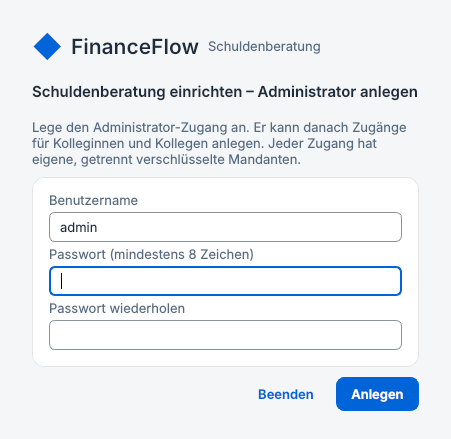
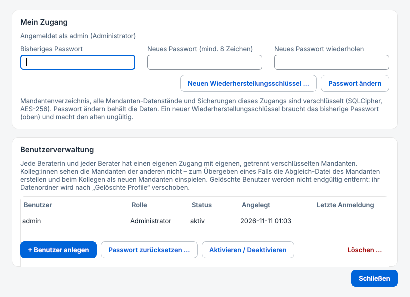
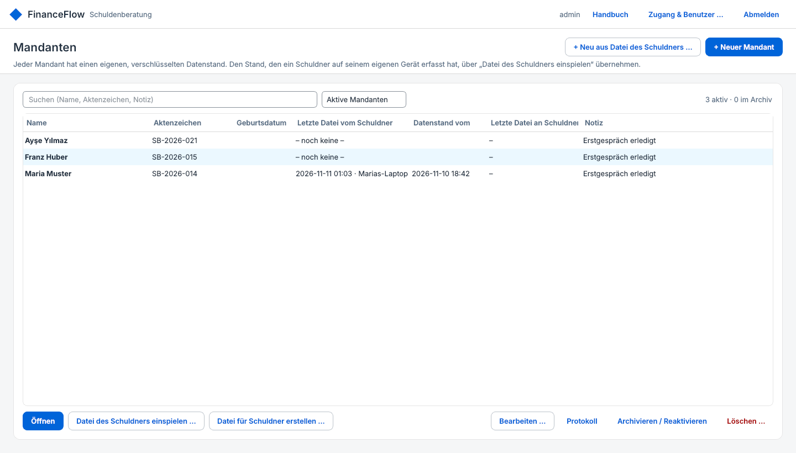
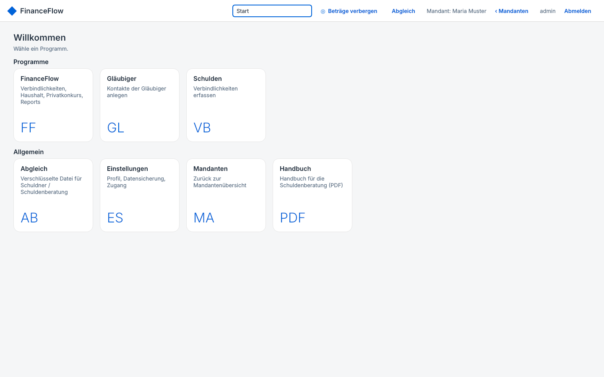
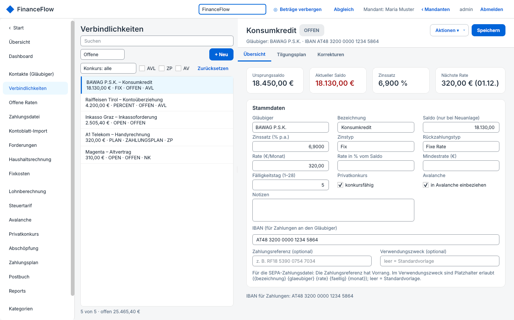
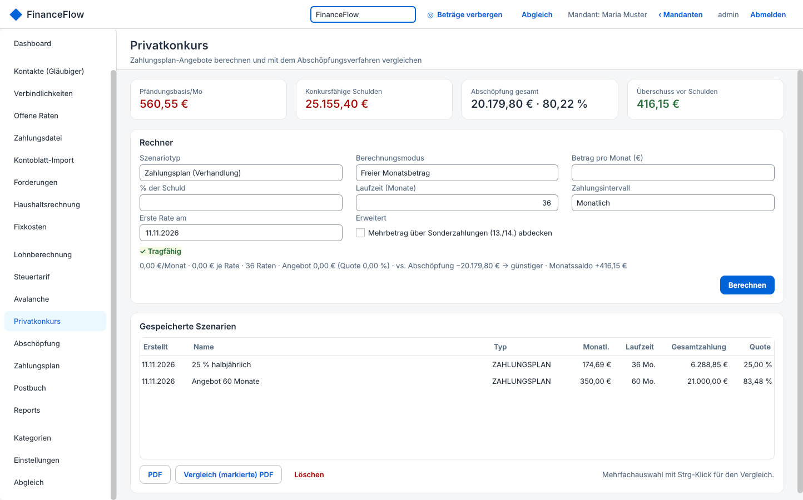
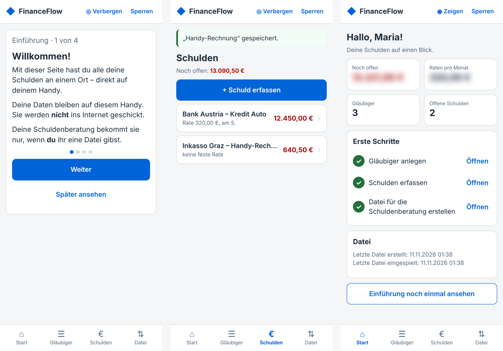

# FinanceFlow Schuldenberatung – Handbuch für Beraterinnen und Berater

Version 1.0.0 (beruht auf FinanceFlow Desktop 2.2.0). Dieses Handbuch beschreibt alle Funktionen der Schuldenberatungs-Ausgabe: Installation, Einrichtung, Benutzer- und Mandantenverwaltung, den Abgleich mit den Schuldnerinnen und Schuldnern sowie sämtliche Fachfunktionen.

## 1. Überblick

### 1.1 Zwei Betriebsarten auf einer Installation

FinanceFlow Schuldenberatung ist **ein** Programm mit zwei Betriebsarten. Welche gilt, wird beim ersten Start auf dem jeweiligen Computer festgelegt und danach nicht mehr geändert.

| | Schuldner | Schuldenberatung |
|---|---|---|
| Zweck | Eigene Schulden erfassen, Datei an die Beratung geben | Mandanten führen, Dateien der Schuldner einspielen |
| Anmeldung | Nur Passwort | Benutzername und Passwort |
| Benutzerverwaltung | Keine | Administrator legt Zugänge für Kolleg:innen an |
| Mandantenverwaltung | Keine (ein einziger Datenstand) | Beliebig viele Mandanten, je eigener Datenstand |
| Einführung | Kurze Einführung in einfacher Sprache beim ersten Öffnen | – (dieses Handbuch) |
| Abgleich | Datei für die Beratung erstellen / Datei der Beratung einspielen | Datei des Schuldners einspielen / Datei für den Schuldner erstellen |

### 1.2 Umfang gegenüber FinanceFlow Desktop

Enthalten ist der vollständige Bereich **FinanceFlow** (Verbindlichkeiten, Haushalt, Privatkonkurs, Reports usw.) und der **verschlüsselte Abgleich**. Nicht enthalten sind die Module **HR & Worktime**, **Aviation Tools** (einschließlich Tankbuch), **Mobile Erfassung** und **Kassabuch Devisen**.

Das Dateiformat des Abgleichs (`*.ffsync`) ist dasselbe wie bei FinanceFlow Desktop, Android und iPhone. Dateien aus der Vollversion lassen sich einspielen; nicht enthaltene Module (z. B. Mobile Erfassung) werden dabei ignoriert.

### 1.3 Datenfluss zwischen Schuldner und Beratung

1. Der Schuldner installiert FinanceFlow auf seinem eigenen Computer, wählt „Schuldner“ und erfasst Gläubiger und Verbindlichkeiten.
2. Er erstellt eine **Abgleich-Datei** (verschlüsselt mit einem Passwort, mindestens 12 Zeichen) und übermittelt sie der Beratung, z. B. per E-Mail oder USB-Stick. Das Passwort teilt er getrennt mit (Telefon, persönlich).
3. Die Beratung spielt die Datei beim **Mandanten** ein. Der Datenstand des Mandanten wird dadurch vollständig ersetzt (vorher automatische Sicherung).
4. Die Beratung arbeitet mit dem Datenstand (Korrekturen, Zahlungsplan, Berichte) und gibt bei Bedarf eine **Datei für den Schuldner** zurück, die dieser bei sich einspielt.

> Der Abgleich ersetzt immer den gesamten Datenstand – er führt keine Änderungen zusammen. Vereinbaren Sie deshalb mit dem Schuldner, wer gerade „führt“: Solange die Beratung am Datenstand arbeitet, sollte der Schuldner nichts eintragen, und umgekehrt. Das Programm warnt, wenn beim Einspielen lokale Änderungen verloren gehen würden.

## 2. Installation und Verteilung

### 2.1 Voraussetzungen

- Windows 10 oder Windows 11, 64 Bit.
- Für die Installation per MSI: Administratorrechte (Installation für alle Benutzer des Computers).
- Kein Server, keine Internetverbindung, keine Datenbank-Installation erforderlich.

### 2.2 Installation mit dem MSI-Paket

Doppelklick auf `FinanceFlow-Schuldenberatung-<Version>.msi`, Rückfrage der Benutzerkontensteuerung bestätigen. Installiert werden:

- `C:\Program Files\FinanceFlow Schuldenberatung\FinanceFlow-Schuldenberatung.exe`
- die beiden Anleitungen (PDF) im Unterordner `hilfe`
- Startmenü-Ordner „FinanceFlow Schuldenberatung“ mit Programm, Anleitung für Schuldner und diesem Handbuch
- Verknüpfung am Desktop

**Stille Verteilung durch die IT** (z. B. Softwareverteilung, Intune, GPO):

`msiexec /i FinanceFlow-Schuldenberatung-1.0.0.msi /qn`

**Aktualisieren:** Neueres MSI einfach installieren – die alte Version wird automatisch ersetzt. Daten und Einstellungen bleiben erhalten. Vor dem ersten Start einer neuen Version legt das Programm automatisch eine Sicherung jeder geöffneten Datenbank an.

**Deinstallieren:** Über „Apps & Features“ bzw. `msiexec /x …`. Entfernt wird nur das Programm. Die Daten im Ordner `%APPDATA%\FinanceFlow\Schuldenberatung` bleiben erhalten und müssen bei Bedarf gesondert gelöscht werden (siehe Kapitel 10).

### 2.3 Ablage der Daten

Alle Daten liegen je Windows-Benutzer unter `%APPDATA%\FinanceFlow\Schuldenberatung` – getrennt von einer eventuell installierten FinanceFlow-Vollversion.

| Datei / Ordner | Inhalt |
|---|---|
| `benutzer.db` | Zugänge (Name, Passwort-Hash, umhüllte Schlüssel), Betriebsart |
| `profile\<ID>\` | Bereich je Berater:in (beim Administrator: der Basisordner selbst) |
| `…\mandanten.db` | Mandantenverzeichnis des Zugangs (verschlüsselt) |
| `…\mandanten\<ID>\daten.db` | Datenstand eines Mandanten (verschlüsselt) |
| `…\mandanten\<ID>\Sicherungen` | Automatische Sicherungen des Mandanten (verschlüsselt) |
| `…\mandanten\<ID>\Berichte` | Erstellte PDF-Berichte (unverschlüsselt) |
| `…\Gelöschte Mandanten` | Ordner gelöschter Mandanten |
| `Gelöschte Profile` | Ordner gelöschter Zugänge |

Ordnernamen sind zufällige IDs; aus dem Dateisystem sind keine Namen ablesbar.

## 3. Ersteinrichtung in der Beratungsstelle

1. Programm starten. Bei der Frage „Wer verwendet FinanceFlow?“ **„Ich bin Schuldenberaterin / Schuldenberater“** wählen.
2. **Administrator anlegen:** Benutzername (Vorschlag „admin“) und Passwort (mindestens 8 Zeichen) zweimal.
3. Der **Wiederherstellungsschlüssel** des Administrators wird einmalig angezeigt (Form `XXXX-XXXX-…`, 32 Zeichen). Ausdrucken oder speichern und **getrennt vom Computer** aufbewahren (Tresor, Passwort-Manager der Stelle).
4. Anmelden. Es erscheint die **Mandantenübersicht**.
5. Unter **„Zugang & Benutzer …“** Zugänge für die Kolleginnen und Kollegen anlegen (Kapitel 4).

> Die Betriebsart lässt sich nach der Einrichtung nicht ändern. Wurde versehentlich „Schuldner“ gewählt, Programm schließen, den Ordner `%APPDATA%\FinanceFlow\Schuldenberatung` umbenennen oder löschen und neu starten.

## 4. Zugang und Benutzerverwaltung

Erreichbar in der Mandantenübersicht über **„Zugang & Benutzer …“**.

### 4.1 Mein Zugang

- **Passwort ändern:** bisheriges Passwort und zweimal das neue eingeben, „Passwort ändern“. Daten bleiben unverändert.
- **Neuer Wiederherstellungsschlüssel:** bisheriges Passwort eingeben, „Neuen Wiederherstellungsschlüssel …“. Der alte Schlüssel wird ungültig.
- **Passwort vergessen:** In der Anmeldemaske „Passwort vergessen …“: Benutzername, Wiederherstellungsschlüssel und neues Passwort.

### 4.2 Benutzerverwaltung (nur Administrator)

| Aktion | Wirkung |
|---|---|
| + Benutzer anlegen | Neuer Zugang mit eigenem, leerem und eigens verschlüsseltem Bereich. Der Wiederherstellungsschlüssel des neuen Zugangs wird angezeigt – der Person übergeben. |
| Passwort zurücksetzen … | Nur mit dem **Wiederherstellungsschlüssel** dieses Zugangs möglich. Ohne ihn bleiben dessen Mandanten gesperrt – auch für den Administrator. |
| Aktivieren / Deaktivieren | Deaktivierte Zugänge können sich nicht anmelden; Daten bleiben erhalten. |
| Löschen … | Die Anmeldung wird entfernt, der Datenordner (mit allen Mandanten) nach „Gelöschte Profile“ verschoben. |

> Jeder Zugang sieht ausschließlich seine eigenen Mandanten. Der Administrator hat **keinen** Einblick in die Mandanten der Kolleg:innen. Zur Übergabe eines Falls siehe Abschnitt 5.6.

## 5. Mandantenverwaltung

Nach der Anmeldung erscheint die Mandantenübersicht.

### 5.1 Liste, Suche und Archiv

Die Tabelle zeigt je Mandant: Name, Aktenzeichen, Geburtsdatum, **letzte Datei vom Schuldner** (Zeitpunkt des Einspielens und Gerätename), **Datenstand vom** (Erstellungszeitpunkt der eingespielten Datei), **letzte Datei an den Schuldner** und Notiz. Das Suchfeld durchsucht Name, Aktenzeichen und Notiz. Über die Auswahl rechts daneben wechseln Sie zwischen **aktiven** Mandanten und dem **Archiv**.

### 5.2 Mandant anlegen und bearbeiten

- **+ Neuer Mandant:** Name (Pflicht), Aktenzeichen/Klientennummer, Geburtsdatum, Telefon, E-Mail, Notiz. Der Name wird beim ersten Öffnen als Name im PDF-Kopf übernommen (änderbar unter Einstellungen → Allgemein).
- **+ Neu aus Datei des Schuldners …:** Abgleich-Datei wählen, Passwort eingeben, Inhalt prüfen (Name aus der Datei, Gerät, Erstellungszeitpunkt, Anzahl Kontakte und offener Verbindlichkeiten), Stammdaten bestätigen – der Mandant wird angelegt und die Datei sofort eingespielt.
- **Bearbeiten …:** Stammdaten ändern.

### 5.3 Öffnen

**Öffnen** (oder Doppelklick) öffnet den Datenstand des Mandanten im Hauptfenster (Kapitel 7). Ein Mandant kann nur in einem Fenster gleichzeitig geöffnet sein.

### 5.4 Archivieren, Protokoll, Löschen

- **Archivieren / Reaktivieren:** verschiebt den Mandanten ins Archiv bzw. zurück. Daten bleiben vollständig erhalten.
- **Protokoll:** zeigt Anlage, Änderungen, jedes Einspielen und Erstellen einer Abgleich-Datei mit Zeit, Gerät und Benutzer.
- **Löschen …:** entfernt den Mandanten aus der Liste und verschiebt seinen Datenordner nach „Gelöschte Mandanten“ (nicht vernichtet, weiterhin verschlüsselt).

### 5.5 Abgleich direkt aus der Übersicht

- **Datei des Schuldners einspielen …** – für den markierten Mandanten (Kapitel 6).
- **Datei für Schuldner erstellen …** – für den markierten Mandanten, ohne ihn zu öffnen.

### 5.6 Fall an eine Kollegin oder einen Kollegen übergeben

1. Mandant markieren → „Datei für Schuldner erstellen …“ (ein Passwort vergeben).
2. Die Kollegin wählt in ihrer Übersicht „+ Neu aus Datei des Schuldners …“ und spielt die Datei ein.
3. Beim abgebenden Zugang den Mandanten archivieren oder löschen.

## 6. Datenstand des Schuldners übernehmen

### 6.1 Was der Schuldner tut

Der Schuldner klickt in seinem Programm auf **Abgleich → „Datei für die Schuldenberatung erstellen …“**, vergibt ein Passwort (mindestens 12 Zeichen) und übermittelt die Datei (`FinanceFlow-JJJJ-MM-TT-hhmm-<Gerät>.ffsync`). Die Anleitung für Schuldner beschreibt das in einfacher Sprache.

> Empfehlung: Passwort beim Termin oder telefonisch vereinbaren, niemals in derselben E-Mail wie die Datei. Die Datei ist ohne Passwort nicht lesbar (AES-256-GCM).

### 6.2 Einspielen

1. Mandant markieren → **„Datei des Schuldners einspielen …“** (oder im geöffneten Mandanten unter Abgleich).
2. Datei wählen, Passwort eingeben.
3. Das Programm zeigt den Inhalt: Name im PDF-Kopf der Datei, Gerät, Erstellungszeitpunkt, Anzahl Kontakte und offener Verbindlichkeiten. Bestätigen.
4. **Namensprüfung:** Weicht der Name in der Datei vom Mandantennamen ab, fragt das Programm nach, bevor eingespielt wird.
5. **Konfliktprüfung:** Wurde der Datenstand des Mandanten seit dem letzten Abgleich in der Beratung geändert, erscheint eine Warnung mit drei Möglichkeiten: **Zuerst exportieren** (aktuellen Stand als Datei sichern, dann einspielen), **Trotzdem einspielen** oder **Abbrechen**.
6. Vor dem Ersetzen wird automatisch eine Sicherung angelegt (`Sicherungen\daten_…_vor_abgleich.db`). Der Import läuft in einer Transaktion: Bei einem Fehler bleibt der bisherige Stand unverändert.

Falsches Passwort oder eine beschädigte Datei ergeben „Passwort falsch oder Datei beschädigt“ – es wird nichts geändert. Dateien aus einer neueren Programmversion werden mit dem Hinweis „Bitte App aktualisieren“ abgelehnt.

### 6.3 Datei an den Schuldner zurückgeben

Im Mandanten **Abgleich → „Datei für den Schuldner erstellen …“** (oder in der Übersicht). Passwort vergeben, Datei speichern, übermitteln. Der Schuldner spielt sie unter **Abgleich → „Datei der Schuldenberatung einspielen …“** ein. Hat er inzwischen selbst etwas eingetragen, warnt sein Programm ebenfalls.

### 6.4 Empfohlener Ablauf

| Schritt | Schuldner | Beratung |
|---|---|---|
| Erstgespräch | Installiert das MSI, richtet „Schuldner“ ein, erfasst Gläubiger und Schulden | Legt Mandant an oder wartet auf die Datei |
| Vor dem Termin | Erstellt Datei, schickt sie, nennt Passwort telefonisch | Spielt die Datei ein, prüft Gläubiger und Salden |
| Bearbeitung | Trägt in dieser Zeit nichts ein | Korrekturen, Gläubigerverzeichnis, Zahlungsplan-Szenarien |
| Rückgabe | Spielt die Datei der Beratung ein und führt weiter | Erstellt Datei für den Schuldner |

## 7. Arbeiten im Mandanten

- **Kopfzeile:** Bereichsauswahl (Start / FinanceFlow), **Beträge verbergen** (Strg+B; blendet alle Beträge in der Anzeige aus, z. B. bei Besuch im Büro), **Abgleich**, Name des Mandanten, **‹ Mandanten** (zurück zur Übersicht), angemeldeter Benutzer, **Abmelden**.
- **Startseite:** neutrale Kacheln ohne Beträge: FinanceFlow, Gläubiger, Schulden, Abgleich, Einstellungen, Mandanten, Handbuch.
- **Navigation links:** alle Seiten des Bereichs FinanceFlow; „‹ Start“ bzw. das Logo führt zur Startseite.

## 8. Funktionsreferenz FinanceFlow

### 8.1 Übersicht und Dashboard

**Übersicht:** Kacheln mit Kennzahlen (Gesamtverbindlichkeiten, Anzahl offener Verbindlichkeiten, Forderungen, nächste Raten, Haushaltsüberschuss, Pfändungsbasis, offene Wiedervorlagen) und Stand des letzten Abgleichs. **Dashboard:** Kennzahlen, die fünf größten Verbindlichkeiten, bevorstehende Fälligkeiten und eine 3-Monats-Vorschau. Doppelklick öffnet die Verbindlichkeit.

### 8.2 Kontakte (Gläubiger)

Stammdaten aller Beteiligten: Name, Rolle (**Gläubiger** – Standard bei neuen Kontakten –, Debitor oder beide), Firma, Adresse, Telefon, E-Mail, IBAN, BIC, Notizen. Unten sind die Verbindlichkeiten und Forderungen des Kontakts aufgelistet. „Löschen“ deaktiviert den Kontakt (er bleibt für bestehende Verbindlichkeiten erhalten). Filter nach Rolle, Suche über Name.

### 8.3 Verbindlichkeiten

Liste mit Filtern: Status (Offene, Alle, Zahlungsplan, Bezahlt), Konkursfähigkeit (alle / konkursfähig / nicht konkursfähig) und Merkmale **AVL** (in Avalanche), **ZP** (Zahlungsplan), **AV** (im Abschöpfungsverfahren). Kennzeichen in der Liste: NK = nicht konkursfähig.

**Stammdaten:**

| Feld | Bedeutung |
|---|---|
| Gläubiger | Kontakt (muss vorher angelegt sein) |
| Bezeichnung | z. B. „Konsumkredit“, „Handyrechnung“ |
| Saldo | Offener Betrag bei Neuanlage. Danach nur über Korrekturen änderbar (nachvollziehbare Historie). |
| Zinssatz, Zinstyp | % p.a., fix oder variabel; Grundlage für Tilgungsplan und Avalanche |
| Rückzahlungstyp | Fixe Rate · Prozent vom Saldo (mit Mindestrate) · Offen/revolvierend · Ratenplan |
| Rate, Fälligkeitstag | Monatsrate und Tag (1–28) |
| konkursfähig | Ob die Forderung im Schuldenregulierungsverfahren berücksichtigt wird |
| in Avalanche einbeziehen | Für die Avalanche-Berechnung |
| IBAN | Zahlungsempfänger; leer = IBAN des Kontakts. Prüfziffer wird geprüft. Erscheint im Gläubigerverzeichnis. |
| Zahlungsreferenz / Verwendungszweck | Für die SEPA-Zahlungsdatei (Platzhalter siehe 8.6) |

**Karteikarten:** *Übersicht* (Kennzahlen: Ursprungssaldo, aktueller Saldo, Zinssatz, nächste Rate), *Tilgungsplan* (Monatsplan mit Zinsen, Tilgung, Restsaldo; „Markierte Rate bezahlen …“), *Korrekturen* (Historie; „Korrektur buchen …“, „Letzte Korrektur löschen“).

**Korrekturtypen:** Saldoanpassung, Zinsnachtrag, Gerichtskosten/Verfahrenskosten, Teilerlass/Verzicht, Umwandlung in Zahlungsplan, Inkassokosten, Anpassung Tagsatzung (neuer Saldo), Ratenzahlung, Sonstige Korrektur. Eingabe als Änderungsbetrag (+ erhöht, − senkt den Saldo); bei „Anpassung Tagsatzung“ wird der neue Saldo direkt eingegeben. Nur die jeweils **letzte** Korrektur kann gelöscht werden; dabei werden Saldo und ggf. die bezahlte Planzeile wiederhergestellt.

**Menü „Aktionen ▾“:** Korrektur buchen · In Zahlungsplan umwandeln (Quote in % des Saldos, Laufzeit, Intervall, erste Rate) · Zahlungsplan rückgängig · Tilgungsplan neu berechnen · Als bezahlt markieren · Reaktivieren · PDF Tilgungsplan · PDF Buchungsmitteilung · Löschen (nur ohne Historie; sonst als bezahlt markieren).

### 8.4 Offene Raten

Die erste offene Planrate je Verbindlichkeit, nach Fälligkeit sortiert; überfällige Raten rot. Kennzahlen: Anzahl, Summe, davon überfällig. „Rate bezahlen …“ (oder Doppelklick) bucht die Rate als Korrektur „Ratenzahlung“. Weiter: PDF, Sprung zur Zahlungsdatei.

### 8.5 Forderungen

Forderungen des Mandanten gegenüber Dritten (Kontakte mit Rolle Debitor): Betrag, Zinsen, Fälligkeit, Zahlungsbedingungen. „Zahlung erfassen …“ legt eine Zahlung an; PDF je Forderung.

### 8.6 Zahlungsdatei (SEPA)

Erstellt eine SEPA-Überweisungsdatei (ISO 20022 pain.001.001.09, wahlweise .03) mit der nächsten offenen Rate je Verbindlichkeit zum Hochladen ins Online-Banking.

1. Einmalig **Auftraggeber** erfassen: Kontoinhaber, IBAN, BIC (optional), Format, Standard-Verwendungszweck mit Platzhaltern `{bezeichnung} {glaeubiger} {rate} {faellig} {monat}`, Sammelbuchung ja/nein.
2. „Fällig bis“ und „Ausführung am“ wählen, Raten anhaken, **XML-Datei erstellen**. Die Datei bucht noch nichts.
3. Nach der Ausführung durch die Bank unter „Erstellte Dateien“ **Als bezahlt erfassen …** (je Rate eine Korrektur „Ratenzahlung“) – oder **Verwerfen …**, wenn die Datei nicht eingereicht wurde.

Empfänger-IBAN: die der Verbindlichkeit, sonst die des Kontakts. Sonderzeichen werden auf den SEPA-Zeichensatz gebracht; Beträge centgenau.

### 8.7 Kontoblatt-Import

Liest ein Kontoblatt (CSV aus einer Buchhaltung: `Datum;Beleg;Belegkreis;Fremdbeleg;Konto;Text;Gegenkonto;Soll;Haben;Saldo;S/H;Storno`) und bucht neue Zeilen als Korrekturen bei der zugeordneten Verbindlichkeit (Änderung = Haben − Soll). Die Zuordnung Konto → Verbindlichkeit wird gemerkt; bereits gebuchte oder ignorierte Zeilen werden nicht erneut angeboten. Vorher automatische Sicherung. Für Mandanten, deren Verbindlichkeiten in einer Buchhaltung geführt werden.

### 8.8 Haushaltsrechnung und Fixkosten

**Haushaltsrechnung:** Einnahmen (aus SOLL-Lohnberechnung, Szenario-Lohnberechnung oder manuell) gegenüber Fixkosten, variablen Ausgaben und Schuldendienst; Ergebnis Überschuss/Fehlbetrag pro Monat. Mehrere **Szenarien** (z. B. „aktuell“, „nach Jobwechsel“) mit eigenen Ausgaben; Filter nach Kategorien; PDF.
**Fixkosten:** Monatsansicht aller Fixkosten mit Fälligkeitstag; „Als bezahlt markieren …“ und „Zurücknehmen“.

### 8.9 Lohnberechnung und Steuertarif

**Lohnberechnung:** Netto aus Brutto (oder Stunden × Stundensatz) nach österreichischem Recht – Sozialversicherung, Lohnsteuer, Sonderzahlungen (13./14.) – sowie **Existenzminimum und pfändbarer Betrag nach § 291a EO** (laufend, je Sonderzahlung, Jahres- und Monatsbasis). Typen: **SOLL** (Grundlage für Haushalt und Privatkonkurs), **IST**, **SZENARIO**. PDF je Berechnung.
**Steuertarif:** Jahrestarifstufen nach § 33 EStG; daraus wird die monatliche Lohnsteuertabelle abgeleitet.

> Die Rechenparameter (Grundbetrag Existenzminimum, Sozialversicherungssätze, AV-Staffel, Lohnsteuer) stehen unter Einstellungen und sind **jährlich zu prüfen** und anzupassen.

### 8.10 Avalanche

Schuldenabbau nach der Lawinen-Methode: Ein Monatsbudget wird auf die einbezogenen Verbindlichkeiten verteilt – Mindestraten für alle, der Überschuss jeweils auf die höchstverzinste offene Schuld. Ergebnis: Laufzeit und Zinsen im Vergleich zu „nur Mindestraten“, Zinsersparnis, Monatsplan. „Plan speichern“ sichert das Ergebnis.

### 8.11 Privatkonkurs

Rechner für das Schuldenregulierungsverfahren auf Basis der Pfändungsbasis (SOLL-Lohnberechnung) und der konkursfähigen Verbindlichkeiten.

- **Szenariotyp:** Zahlungsplan (Verhandlung) oder Tilgungsplan (Abschöpfung, Laufzeit laut Einstellungen).
- **Berechnungsmodus:** freier Monatsbetrag oder Prozentsatz der Schuld; Laufzeit, Zahlungsintervall, erste Rate; Option „Erweitert“ (Mehrbetrag über Sonderzahlungen).
- **Ergebnis:** Gesamtzahlung, Quote, Betrag je Rate, Anzahl Raten, Aufteilung je Gläubiger. Szenario unter einem Namen speichern.
- **Gespeicherte Szenarien:** PDF je Szenario, **Vergleich** mehrerer markierter Szenarien als PDF.

Centgenaue Rechenregel (identisch in allen FinanceFlow-Ausgaben): Quotenbetrag je Gläubiger = gerundet(Saldo × Quote); Gesamtzahlung = Summe dieser Beträge; n − 1 gleiche Raten, die letzte planmäßige Rate nimmt die Rundungsdifferenz auf.

### 8.12 Zahlungsplan

Mehrere Verbindlichkeiten mit **einheitlicher Quote** in einen Zahlungsplan umwandeln: Verbindlichkeiten markieren, Quote %, Laufzeit, Intervall und erste Rate eingeben, **Festsetzen**. Darunter die offenen Raten je Termin: „Markierte Rate buchen“ oder „Ganzen Termin buchen“ (Korrektur „Ratenzahlung“).

### 8.13 Abschöpfung

Abschöpfungsverfahren abbilden: Verbindlichkeiten markieren, Beginn und Dauer (Monate) eingeben, **Verfahren auslösen**. Die Quoten werden aus den aktuellen Salden eingefroren; Soll je Rate ist die aktuelle Pfändungsbasis aus der SOLL-Lohnberechnung. Danach Raten buchen bzw. zurücknehmen (auf die Verbindlichkeiten nach Quote verteilt), am Ende **Restschuldbefreiung …**; bei Bedarf **Verfahren abbrechen**.

### 8.14 Postbuch

Ein- und Ausgangspost mit Datum, Absender/Empfänger, Betreff, Referenz (z. B. Aktenzahl), Sendungsnummer, Notizen und **Wiedervorlage**. Antworten werden als Verlauf erfasst („Antwort erfassen …“), Einträge als erledigt markiert. PDF je Monat. Offene Wiedervorlagen erscheinen auf der Übersicht.

### 8.15 Reports

Alle PDF-Berichte (Ablage im Ordner „Berichte“ des Mandanten): Verbindlichkeitenübersicht · **Gläubigerverzeichnis** (alle, konkursfähige oder nicht konkursfähige; mit IBAN) · Zahlungsplan-Übersicht · Offene Raten · 12-Monats-Vorschau · Tilgungsplan und Buchungsmitteilung je Verbindlichkeit · Forderungsübersicht · Haushaltsrechnung · Postbuch je Monat · Lohnberechnung · Privatkonkurs-Szenario · Szenario-Vergleich. Name und Adresse im PDF-Kopf kommen aus Einstellungen → Allgemein.

### 8.16 Kategorien

Kategorien für Fixkosten und Ausgaben (Fix, Variabel, Sonstig, Einkommen), mit Unterkategorien, Farbe und Sortierung.

### 8.17 Einstellungen

- **Rechenparameter:** Pfändungsberechnung (§ 291a EO: Grundbetrag, Rundungsintervall, Koeffizient), Lohnsteuer, Sozialversicherung, AV-Staffel, Laufzeit des Abschöpfungsverfahrens. Dezimalwerte mit Punkt (z. B. `0.0387`).
- **Allgemein:** Name, Straße, PLZ/Ort für den PDF-Kopf, Währung.
- **Alle Tilgungspläne neu berechnen.**
- **Datensicherung:** Jetzt sichern, Sicherungsordner öffnen, verschlüsselt exportieren/importieren (gleich wie Abgleich).
- **Änderungsprotokoll:** die letzten 200 Änderungen.

Im Mandanten gibt es keine Karte „Mein Zugang“ – Zugang und Benutzer werden in der Mandantenübersicht verwaltet.

## 9. Was der Schuldner sieht

Damit Sie Schuldner am Telefon anleiten können:

- **Erster Start:** Auswahl „Ich bin Schuldnerin / Schuldner“, Name (freiwillig, für den PDF-Kopf), Passwort, Wiederherstellungsschlüssel.
- **Anmeldung:** nur Passwort.
- **Einführung:** sechs kurze Seiten in einfacher Sprache (Willkommen, Gläubiger anlegen, Schulden erfassen, weitere Funktionen, Datei an die Beratung, Datenschutz); am Ende „Jetzt ersten Gläubiger anlegen“. Jederzeit erneut über die Kachel „Einführung“.
- **Startseite:** „Erste Schritte“ mit drei Schritten und Häkchen (Gläubiger angelegt, Schulden erfasst, Datei erstellt), Kacheln, „Anleitung“ (PDF).
- **Hinweis:** Will der Schuldner eine Verbindlichkeit anlegen, ohne dass ein Kontakt existiert, erscheint der Hinweis, zuerst den Gläubiger anzulegen.
- Gleicher Funktionsumfang wie im Mandanten, aber ohne Benutzer- und Mandantenverwaltung.

### 9.1 Smartphone-Version für Schuldner ohne Computer

Für Schuldner ohne PC oder Laptop gibt es **FinanceFlow Light** (`https://maebx-cmd.github.io/FinanceFlow-Light/`), die Seite **FinanceFlow-Schuldner.html** – eine einzige HTML-Datei, die vollständig im Browser des Smartphones läuft (keine Installation, keine Verbindung ins Internet, kein Server). Sie liegt im Installationsordner unter `hilfe` und im Startmenü („Smartphone-Version für Schuldner“).

**Umfang:** Einrichten mit Name und Passwort, Einführung (4 Seiten, einfache Sprache), Startseite mit Summen und „Erste Schritte“, Gläubiger anlegen/ändern/löschen (mit IBAN-Prüfung), Schulden erfassen (Gläubiger, Bezeichnung, offener Betrag, feste Rate oder keine, Fälligkeitstag, Zinssatz, IBAN, konkursfähig, Notizen), **neuer Betrag** aus einem Brief oder nach einer Zahlung (wird als Korrektur mit Art, Datum und Beschreibung gespeichert; die letzte eigene kann rückgängig gemacht werden), als bezahlt markieren, Beträge verbergen, Sperren, Passwort ändern.

**Datei:** „Datei erstellen und senden“ erzeugt eine `*.ffsync`-Datei im selben Format wie das Programm (Testvektor geprüft). Auf dem Handy öffnet sich dabei das Teilen-Menü (E-Mail, Messenger …), sonst landet die Datei in den Downloads. Sie wird in der Mandantenübersicht ganz normal eingespielt; als Absender erscheint „Smartphone“ (änderbar), als Ausgabe „Schuldner-Web“. Dateien der Beratung kann der Schuldner unter „Datei öffnen …“ einspielen. Alle Daten, die die Seite nicht selbst bearbeitet (Haushalt, Zahlungspläne, Szenarien, Postbuch …), bleiben dabei unverändert erhalten und gehen mit der nächsten Datei zurück.

**Tilgungspläne:** Die Seite rechnet keine Pläne. Beim Einspielen rechnet FinanceFlow für jede offene Verbindlichkeit ohne offene Planzeilen den Plan automatisch neu; bezahlte Planzeilen bleiben.

**Verteilen:**

| Weg | Hinweise |
|---|---|
| Link (empfohlen) | `https://maebx-cmd.github.io/FinanceFlow-Light/` schicken (oder die Datei auf einem eigenen Webspeicher der Stelle ablegen). Funktioniert auf iPhone und Android. Die Seite wird nur geladen; Daten werden nie gesendet. „Zum Home-Bildschirm“ hinzufügen lassen. |
| HTML-Datei | Per E-Mail schicken. Android: speichern und mit Chrome öffnen. iPhone: Die Dateien-App zeigt HTML nur als Vorschau ohne Funktionen – dort den Link verwenden. |

**Speicherung am Handy:** Der Datenstand liegt im Speicher des Browsers, verschlüsselt mit dem Passwort des Schuldners (PBKDF2 600.000 / AES-256-GCM). Löscht der Schuldner die Browserdaten oder geht das Handy verloren, ist dieser Stand weg; Safari kann Daten von Seiten, die länger nicht geöffnet wurden, entfernen. Die Seite erinnert deshalb an eine Datei, sobald seit mehr als 7 Tagen Änderungen ohne Datei vorliegen – die letzte Datei an die Beratung ist zugleich die Sicherung. Ohne das Passwort lässt sich der Stand am Handy nicht öffnen; „Neu beginnen“ und eine vorhandene Datei einspielen hilft weiter.

## 10. Datensicherheit und Datenschutz

- **Verschlüsselung:** Alle Datenbanken und Sicherungen sind mit SQLCipher 4 (AES-256, HMAC-SHA512) verschlüsselt. Jeder Zugang hat einen zufälligen 256-Bit-Schlüssel, der nur umhüllt gespeichert wird (scrypt + AES-256-GCM, mit Passwort und mit Wiederherstellungsschlüssel). Jeder Mandant hat einen eigenen, daraus abgeleiteten Schlüssel (HMAC-SHA256) – eine Mandanten-Datenbank lässt sich weder mit dem Schlüssel eines anderen Mandanten noch ohne Anmeldung öffnen.
- **Abgleich-Datei:** PBKDF2-HMAC-SHA256 (600.000 Iterationen) und AES-256-GCM; ohne Passwort nicht lesbar. Das Passwort wird nirgends gespeichert.
- **Unverschlüsselt** sind nur bewusst erzeugte Ausgaben: PDF-Berichte und die SEPA-XML-Datei. Diese nach Gebrauch löschen bzw. sicher ablegen.
- **Kein Server:** Es werden keine Daten an Dritte oder ins Internet übertragen.
- **Sicherungen:** täglich, vor jedem Update und vor jedem Einspielen; je Datenbank werden 30 behalten.
- **Löschen nach Ablauf der Aufbewahrungsfrist:** „Löschen“ verschiebt Mandanten nur nach „Gelöschte Mandanten“. Zur endgültigen Löschung den entsprechenden Ordner (und ggf. ältere PDF-Berichte) manuell entfernen. Auf SSDs empfiehlt sich zusätzlich BitLocker für das Laufwerk.
- **Verlust von Passwort und Wiederherstellungsschlüssel** bedeutet den endgültigen Verlust der Daten dieses Zugangs. Wiederherstellungsschlüssel daher zentral und sicher verwahren.

## 11. Fehlerbehebung

| Meldung / Problem | Ursache und Lösung |
|---|---|
| „Dieses Profil ist bereits geöffnet“ | Programm läuft bereits (anderes Fenster) – dort weiterarbeiten. Nur nach einem Absturz die Sperre aufheben. |
| „Dieser Mandant ist gerade geöffnet“ | Mandant ist in einem anderen Fenster offen – dort schließen. |
| „Passwort falsch oder Datei beschädigt“ | Passwort der Abgleich-Datei prüfen (Groß-/Kleinschreibung); ggf. Datei neu anfordern. |
| „Bitte App aktualisieren“ | Die Datei stammt aus einer neueren Programmversion – neues MSI installieren. |
| „Die Datei enthält keine Finanzdaten“ | Keine FinanceFlow-Finanzdatei (z. B. nur Mobile Erfassung aus der Vollversion). |
| Warnung „Änderungen seit dem letzten Abgleich“ | Lokale Änderungen würden überschrieben – „Zuerst exportieren“ wählen oder mit dem Schuldner klären. |
| Name in der Datei weicht ab | Prüfen, ob die richtige Datei beim richtigen Mandanten eingespielt wird. |
| Anmeldung nach mehreren Fehlversuchen verzögert | Schutz gegen Ausprobieren; kurz warten. |
| Datenbank beschädigt | Programm schließen, letzte Sicherung aus dem Ordner „Sicherungen“ des Mandanten anstelle von `daten.db` kopieren. |

## 12. Anhang

### 12.1 Tastenkürzel

| Kürzel | Funktion |
|---|---|
| Strg + B | Beträge verbergen / zeigen |
| Doppelklick in Listen | Öffnen bzw. Standardaktion (Mandant öffnen, Rate bezahlen, PDF) |
| Eingabetaste in der Anmeldung | Anmelden |

### 12.2 Abgleich-Format (Kurzfassung)

Datei `*.ffsync` (JSON): `format` „financeflow-sync“, `version` 1, `kdf` (PBKDF2-HMAC-SHA256, 600.000 Iterationen, Salt), `cipher` (AES-256-GCM, Nonce), `data`. Klartext: `schemaVersion`, `exportedAt`, `device`, `appVersion`, `edition`, `teile.finanzen.daten` mit allen Finanztabellen. Vollständige Beschreibung: `docs/ABGLEICH-FORMAT.md` im Quellcode.
